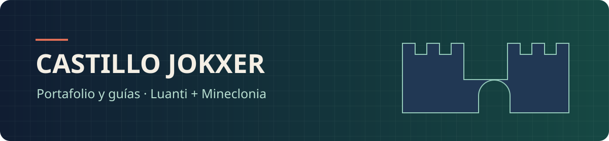
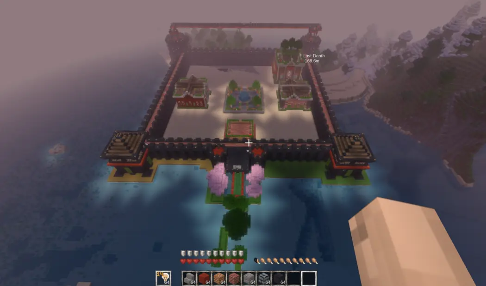

# Castillo Jokxer · Jokxer-Luanti

Soy Kelvin César Del Castillo Torres, **Jokxer**. Construí un castillo costero como punto de encuentro para un mundo cooperativo de supervivencia. El proyecto combina dos trabajos: administrar un servidor de juego propio y diseñar un mundo donde explorar, construir y, más adelante, completar misiones.

| ¿Qué quieres hacer? | Empieza aquí |
| --- | --- |
| 🏰 Ver el mundo y sus edificios | [Recorrido visual](docs/castillo.md) |
| 🧭 Entender cómo se desarrolló | [Historia y decisiones](docs/historia.md) |
| 🎮 Instalar el cliente y jugar | [Guía para jugadores](docs/jugar.md) |
| 🛠️ Montar un servidor propio | [Guía para anfitriones](docs/servidor.md) |
| 📚 Consultar índices | [Documentación](docs/README.md) · [Capturas y planos](assets/README.md) |

**Estado:** desarrollo pausado. En el historial constan edificaciones y pruebas de juego; las misiones propias, NPC personalizados y economía del Castillo siguen en diseño. Esta vitrina no anuncia un servidor público ni distribuye una copia del mundo.

> El nombre «Servidor MineCraft» viene de la etapa inicial con Minecraft Java/Fabric. El mundo que presenta esta vitrina está documentado en **Luanti con Mineclonia**, que utiliza un cliente distinto.

[Volver al perfil de Jokxer](https://github.com/jokxer8#castillo-jokxer)
