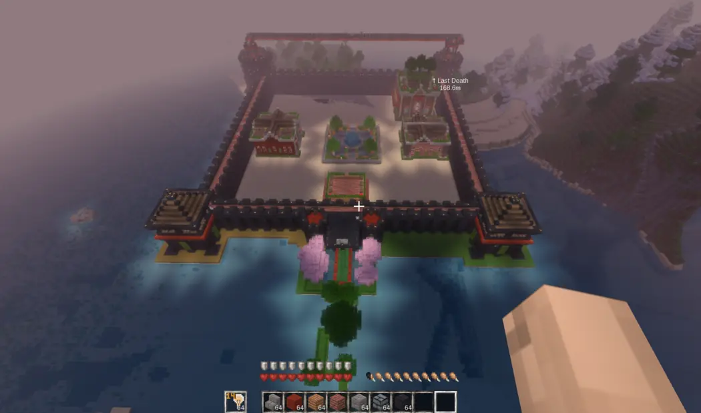
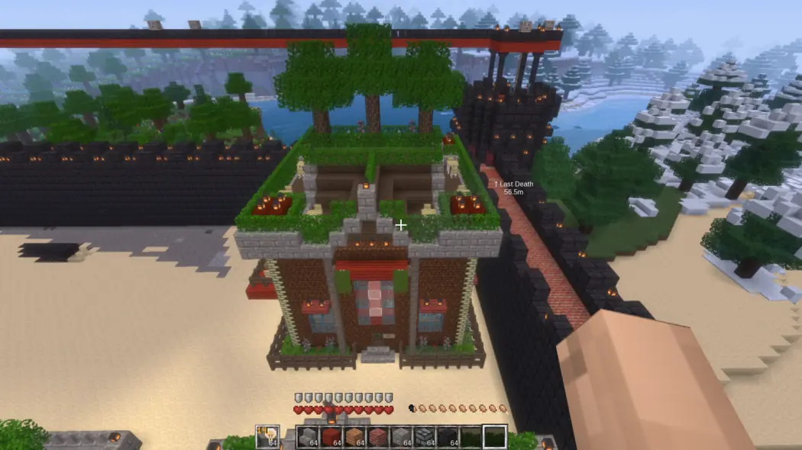
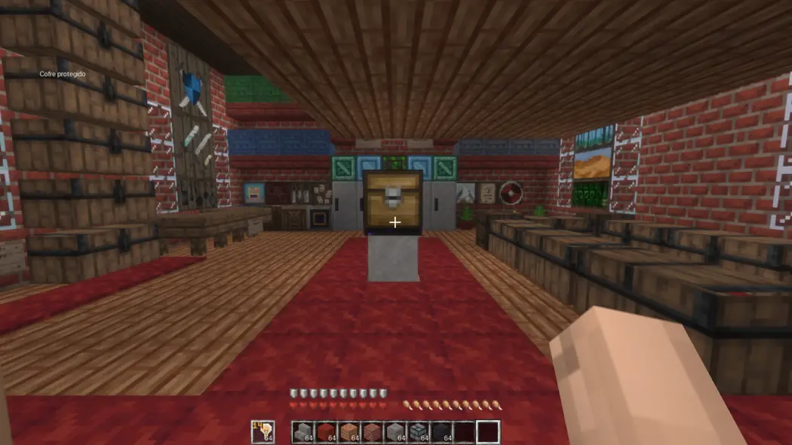
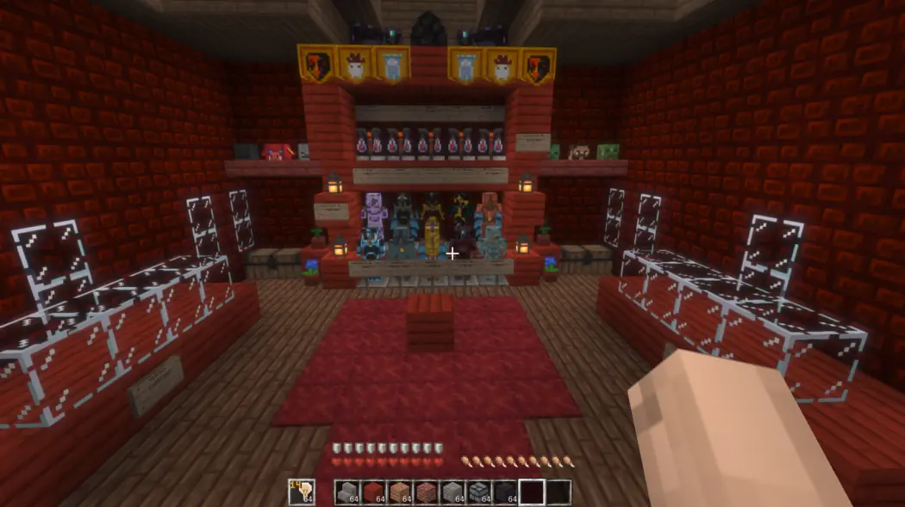
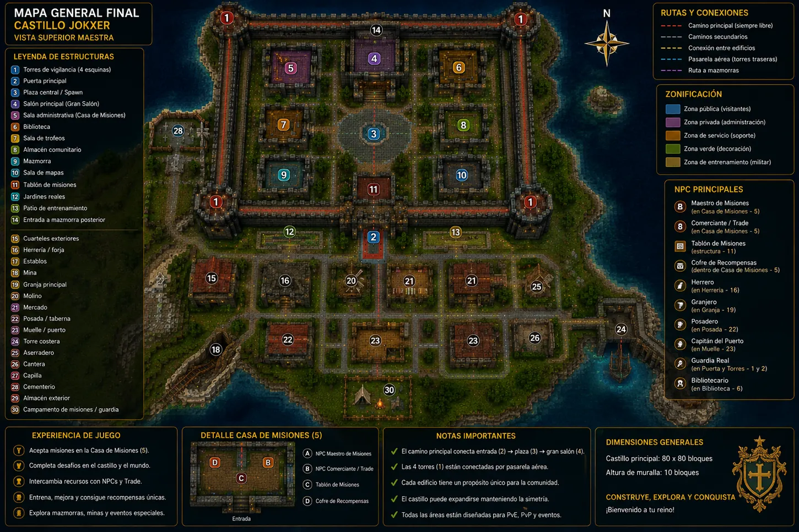
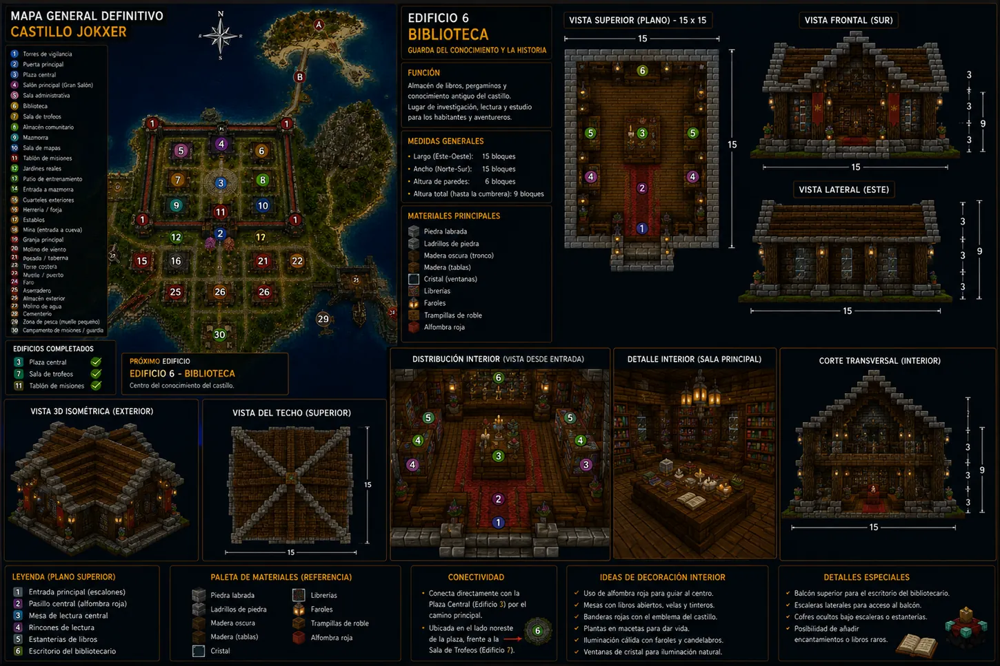

# Recorrido por el Castillo

## Del plano a la obra

El diseño de referencia parte de un recinto de **80 × 80 bloques**, con una plaza que distribuye el recorrido. La dimensión pertenece al plano; no se presenta como una medición actual del mundo.

| Lugar | Qué encontrarás |
| --- | --- |
| Sala de Trofeos | Una sala de exhibición central, con estantes laterales, madera y luz cálida. Su terminación quedó registrada. |
| Almacén Comunitario | Edificio construido para agrupar recursos y separar el abastecimiento de la exhibición. |
| Biblioteca | Dos balcones laterales. El balcón derecho comunica con la escalera a la azotea, que incorporó jardín y zonas de descanso. Estos cambios surgieron durante la construcción. |
| Casa de Misiones | Evolución del antiguo tablón del plano. La casa está documentada; el sistema de misiones aún no. |
| Sala de Mapas | Diseño previsto para preparar y comentar rutas. No se presenta como obra terminada. |

Se decidió ubicar primero los edificios y diseñar los caminos al final. La plaza, la biblioteca y el almacén pueden conectarse sin convertir todos los recorridos en simples pasillos.

## Capturas reales del mundo

### Vista aérea del recinto

Recinto costero, torres, acceso y plaza en la fase fotografiada.

### Biblioteca construida

Jardín en azotea, balcones y paso elevado al fondo.

### Almacén Comunitario

Interior de almacenamiento, con filas de cofres y un cofre protegido en primer plano.

### Sala de Trofeos

Vitrinas laterales y exposición de armaduras al fondo.

## Planos conceptuales

### Plano conceptual del recinto

La ilustración conserva la nomenclatura de aquella fase. El número 11 evolucionó de tablón a Casa de Misiones; rutas, zonas exteriores y NPC del dibujo no prueban implementación.

### Plano conceptual de la biblioteca

El plano servía como referencia de volumen y materiales. Los dos balcones y el jardín que se ven en la captura son cambios adoptados durante la construcción.

Los planos son ilustraciones de diseño; las capturas muestran cómo se construyeron partes del mundo. No se incluye un mapa jugable.

[Historia del proyecto](historia.md) · [Volver al inicio](../README.md)
